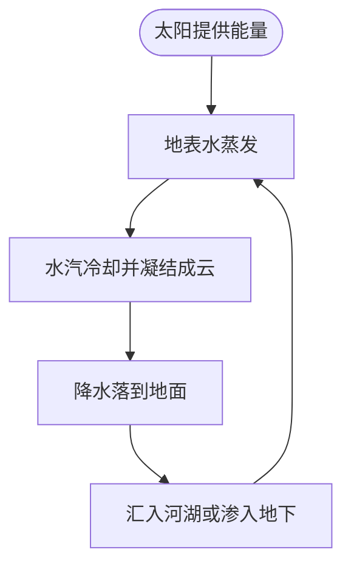

# 示例：我来解释水循环

## 主题

水循环描述水在地表、大气和地下之间不断移动。我选择它，是因为它把日常天气和地球上的水联系起来。

## 结构化简介

- **读者：** 刚开始学习地球科学的高中生。
- **目标：** 说明水如何从地表进入大气，再回到地表。
- **背景：** 太阳提供能量，重力使水向较低处流动。
- **关键事实：** 液态水可以蒸发；水汽冷却后会凝结成云滴；水会以降水形式落下，并汇入河流、湖泊或地下。
- **限制或未知之处：** 水循环没有固定的单一路线；一滴水可能经过不同路径，也可能在地下停留很久。

## Mermaid 流程图

## 给 LLM 的提示词

请面向高中生，根据以上结构化简介，用不超过 150 字解释水循环。说明蒸发、凝结、降水和汇集之间的关系，并指出这张图没有展示的一个细节。不要把水循环说成只有一种固定路线。

## LLM 回答与我的收获

示例回答（为展示作业格式而撰写，并非真实的 LLM 对话）：太阳加热地表水后，部分水变成水汽进入大气。水汽冷却并凝结成云滴，之后以雨或雪等降水形式落下。水可能流入河湖、渗入地下，或再次蒸发。美国地质调查局的[水循环介绍](https://www.usgs.gov/special-topics/water-science-school/science/water-cycle)也说明水循环包含地表水、地下水和大气之间的移动。我学到水循环不是每一滴水都按同一条路线移动。

## 反思

- **结构化内容帮助 LLM 理解了什么？** 读者、解释目标和关键步骤都很明确，因此回答可以聚焦在水循环的主要阶段。
- **LLM 哪些地方出错、遗漏或表达不清？** 这份示例回答很简短，没有解释地下水如何重新进入河流或海洋；正式作业应结合来源继续核对。
- **下次你会如何修改提示词或图表？** 我会要求补充一个地下水的例子，并在图中增加水流向海洋的路径。